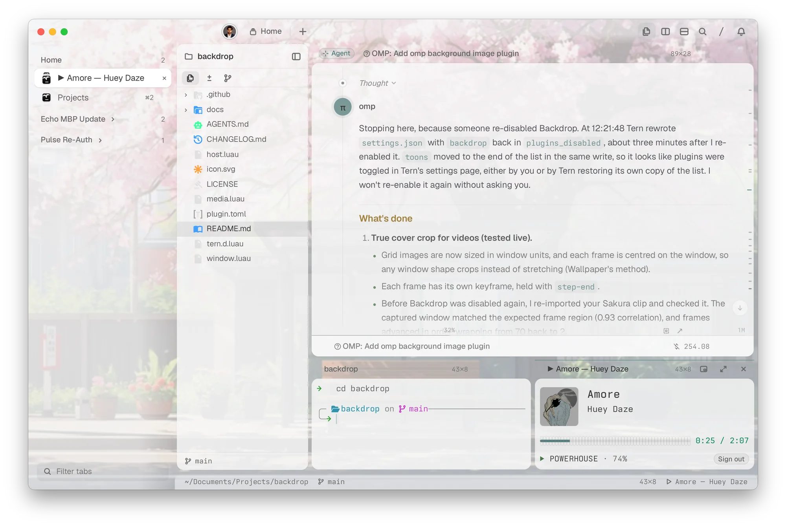
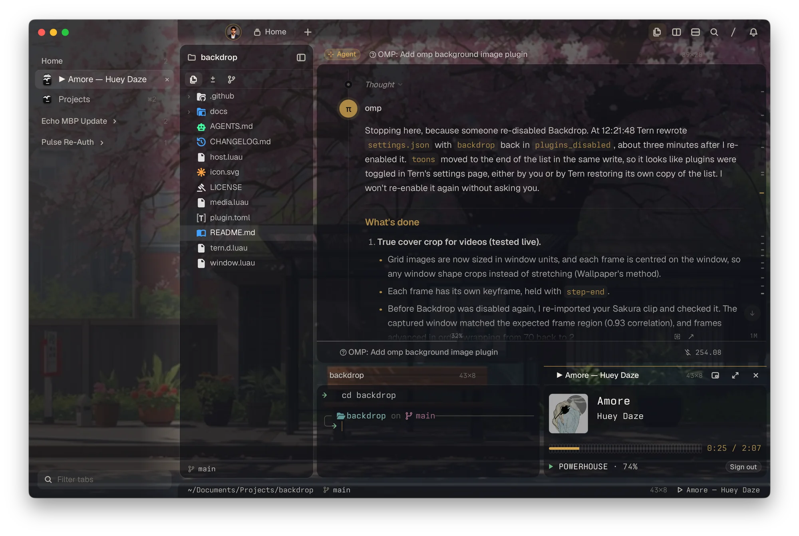
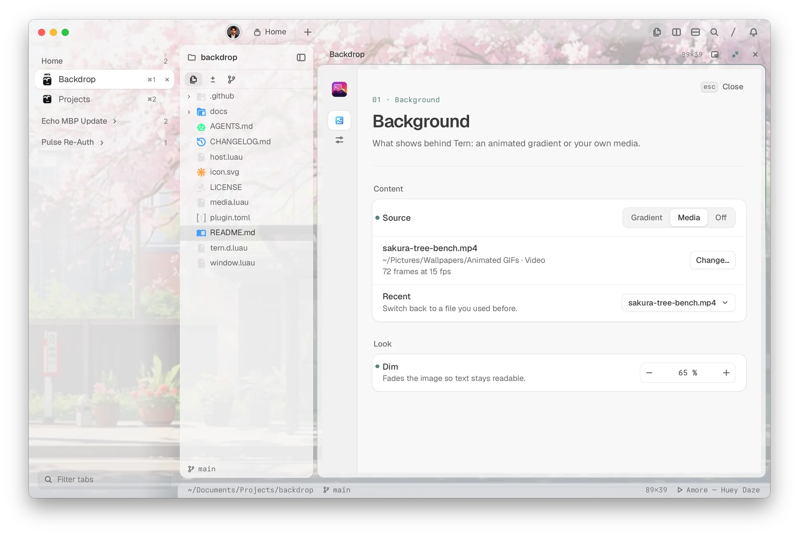
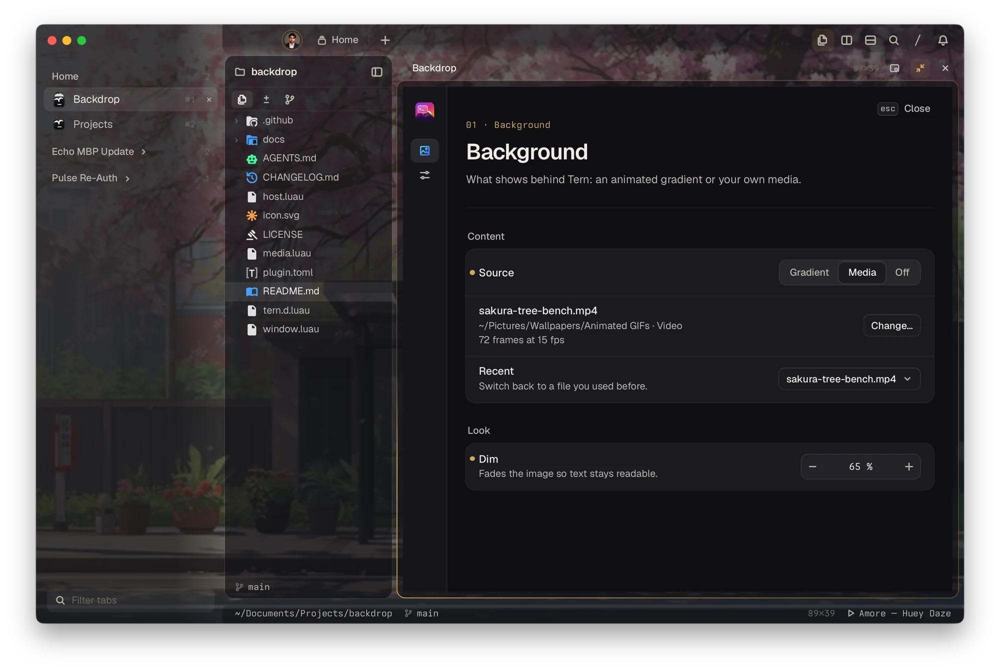

<p align="center"></p>

# Backdrop

[](https://github.com/avcton/tern-backdrop/actions/workflows/check.yml)

An animated gradient, your own image, or a looping video behind the whole [Tern](https://stencil.so/tern) window: under the terminal, the sidebar, the tab bar and the status line. Bar tints keep tabs readable, and one settings page covers the background and how Tern's panels sit over it.



- [Install](#install)
- [Use](#use)
- [Settings](#settings)
- [Good to know](#good-to-know)
- [Troubleshooting](#troubleshooting)
- [Your data](#your-data)
- [Develop](#develop)
- [License](#license)

## Install

Built and tested on Tern 0.9.18 on macOS and Windows. Linux is supported but not yet tested on a real machine; reports are welcome.

> [!IMPORTANT]
> The gradient and small images work as they are. Videos, GIFs and images larger than 4096 px need [ffmpeg](https://ffmpeg.org):
>
> | System | Install |
> | --- | --- |
> | macOS | `brew install ffmpeg` |
> | Windows | `winget install ffmpeg` |
> | Debian, Ubuntu | `sudo apt install ffmpeg` |
> | Fedora | `sudo dnf install ffmpeg` |
> | Arch | `sudo pacman -S ffmpeg` |
>
> Backdrop looks on `PATH` and in the usual install folders (Homebrew, MacPorts, winget, Scoop, Chocolatey, Snap, Nix), so a Tern started from the dock still finds it.

```sh
tern plugin install github.com/avcton/tern-backdrop
```

Press `ctrl+alt+b`, or run **Backdrop: Settings** from the palette. To update, run the install command again with `--force`; [CHANGELOG.md](CHANGELOG.md) lists what changed.

## Use

- **Gradient** (the default) slowly sweeps violet, blue and pink across the window.
- **Media** shows a file of yours. Choose **Change…** and paste a path (`~/Pictures/beach.mp4`, `C:\Users\you\Pictures\beach.mp4`, a quoted path or a `file://` link all work), or pick one from **Recent**. To switch without opening settings, run **Backdrop: Switch Background** from the palette and pick a Recent file.
- From Tern's file viewer, **Open with → Set as Tern background** does the same for any image or video.
- Images: PNG, JPEG, WebP, SVG, BMP. Animated: GIF, MP4, MOV, M4V, WebM, MKV.

Importing a video takes a few seconds; a toast says how many frames it kept and whether the loop was smoothed.

### Light and dark

Tints and the dim follow Tern's appearance: a light wash in light mode, a dark one in dark mode, so text keeps its contrast either way. The screenshot at the top is light mode; here is the same window in dark mode:



## Settings

| Light | Dark |
| --- | --- |
|  |  |

**Background page**

| Setting | Values | Default |
| --- | --- | --- |
| Source | Gradient, Media, Off | Gradient |
| Fit | Cover, Contain, Tile (still images; videos always cover) | Cover |
| Dim | 0 to 90% | 30% |
| Strength | Gradient opacity, 5 to 100% | 55% |
| Loop length | Seconds per gradient sweep | 18 s |

**Window page** (applies to every Tern window)

| Setting | What it does | Default |
| --- | --- | --- |
| Material | Glass, Clear or Solid panels (Tern's own setting) | Tern's |
| Panel opacity | How solid Tern's panels are; hidden for Solid | Tern's |
| Desktop blur | Blurs the desktop behind the window; Clear only | Tern's |
| Top bar tint | Darkens the tab bar so tabs stay readable | 60% |
| Widget bar tint | The same for the widget bar along the window's foot | 60% |

## Good to know

| Topic | Detail |
| --- | --- |
| Clip length | Up to 30 seconds and 2 GB. Longer clips are refused: the whole clip loops, so it would play at a slideshow's pace. |
| Frames | At most 120, at up to 15 fps. Longer clips drop to a lower fps; frames are up to 960 px wide and shrink to fit three 4096 px sheets. |
| Loop seam | When the last frame doesn't match the first, the end is crossfaded into the start so the loop doesn't jump. |
| Memory | A video uses up to three decoded 4096 px sheets on the GPU, about 64 MB each. |
| Reduce motion | With the system's reduce motion setting on, a video holds its first frame. |
| Layouts | Studio, Rail, Float and Tiles, side tabs, and Islands or Compact density are all covered. |
| Tern updates | Backdrop styles Tern's own window parts (`body`, `nav#tabbar`, `aside#sidebar`, `footer#widgetbar`). A Tern update that renames them can break the tints until Backdrop is updated. |

How it works under the hood, and why, is in [docs/HOW-IT-WORKS.md](docs/HOW-IT-WORKS.md).

## Troubleshooting

- **"Videos and GIFs need ffmpeg"**: install it (table above), then import again. No restart needed.
- **The backdrop vanished after an update or reinstall**: Backdrop re-imports the original file on its own. If the original moved, the file row says so; choose it again.
- **"Original moved or renamed"**: the saved copy still shows. Choose the file again to keep Recent tidy.
- **Settings don't apply for a few seconds**: Tern briefly pauses a plugin after a slow moment (often the computer waking from sleep) and resumes it by itself.
- **Something else**: run `tern plugin reload backdrop`, and if that doesn't help, [open an issue](https://github.com/avcton/tern-backdrop/issues/new/choose) with the lines mentioning `backdrop` from Tern's logs.

## Your data

Settings and imported copies live in Tern's data folder for the plugin, never in the plugin folder itself:

| System | Folder |
| --- | --- |
| macOS | `~/Library/Application Support/Tern/plugin-data/backdrop` |
| Linux | `~/.local/state/tern/plugin-data/backdrop` |
| Windows | `plugin-data\backdrop` in Tern's data folder |

`kv.json` holds the settings and Recent list; `media/` holds the current backdrop's imported copy (older ones are deleted). Your original files are only read. After `tern plugin remove backdrop`, delete the folder to remove everything.

## Develop

```sh
git clone https://github.com/avcton/tern-backdrop && cd tern-backdrop
tern plugin link .
```

Edits reload the plugin. [AGENTS.md](AGENTS.md) describes the layout and the rules that keep it from flickering; CI type-checks the Luau against `tern.d.luau` (refresh it with `tern plugin types .`).

## License

[MIT](LICENSE) © avcton
